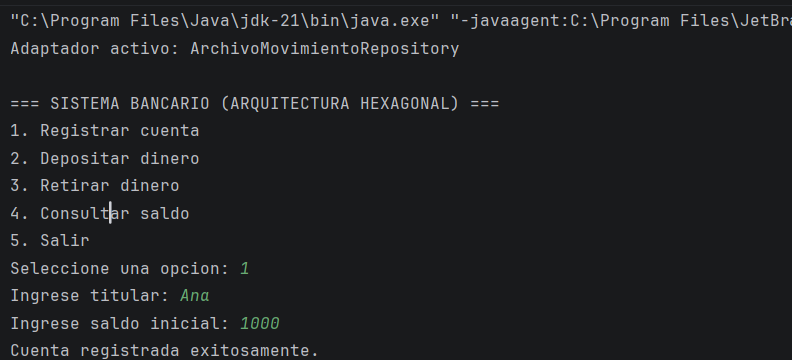
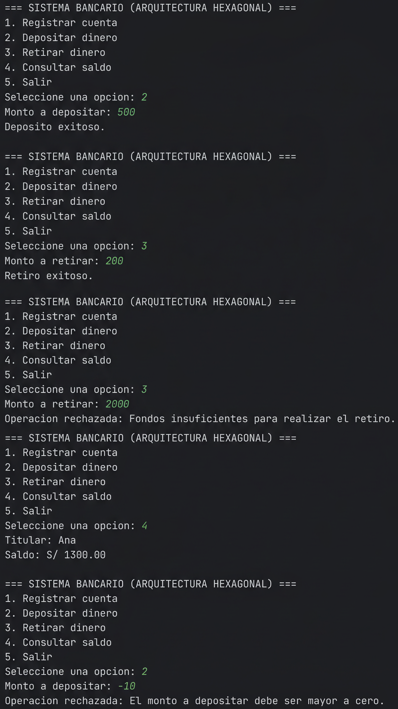
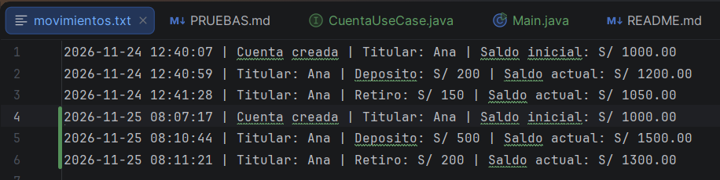
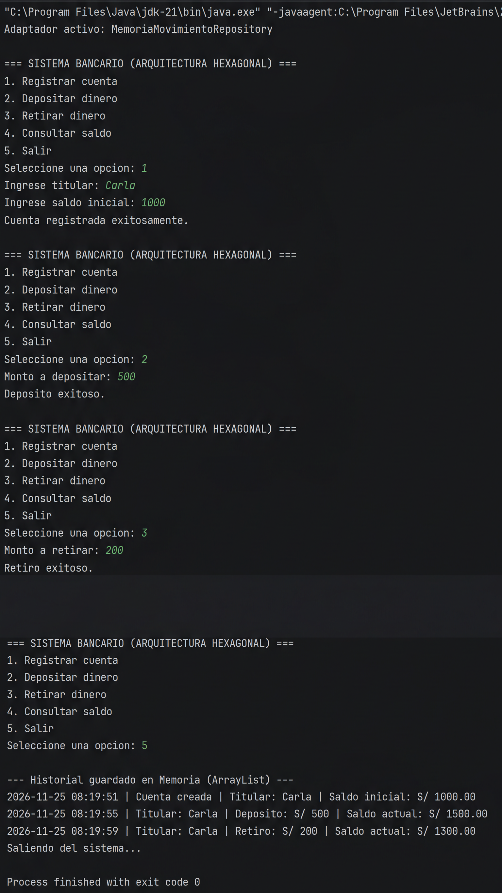

# Matriz de Pruebas - Laboratorio 07-B (Arquitectura Hexagonal)

| ID | Caso de prueba | Entrada ejecutada | Resultado esperado | Resultado obtenido | Estado |
| :--- | :--- | :--- | :--- | :--- | :---: |
| **P01** | Registrar cuenta con saldo 1000 | Opción `1`, Titular: `Ana`, Saldo: `1000` | Registro correcto | Mensaje *"Cuenta registrada exitosamente."* | Aprobado |
| **P02** | Depositar 500 | Opción `2`, Monto: `500` | Saldo 1500 | Mensaje *"Deposito exitoso."* (Saldo `1500.00`) | Aprobado |
| **P03** | Retirar 200 | Opción `3`, Monto: `200` | Saldo 1300 | Mensaje *"Retiro exitoso."* (Saldo `1300.00`) | Aprobado |
| **P04** | Retirar 2000 | Opción `3`, Monto: `2000` | Operación rechazada; saldo 1300 | *"Operacion rechazada: Fondos insuficientes..."* Saldo `1300.00` | Aprobado |
| **P05** | Depositar -10 | Opción `2`, Monto: `-10` | Operación rechazada | *"Operacion rechazada: El monto a depositar debe ser mayor a cero."* | Aprobado |
| **P06** | Probar con adaptador TXT | `ArchivoMovimientoRepository` activo | Se agrega movimiento al archivo | Se registran las líneas con fecha y hora en `movimientos.txt` | Aprobado |
| **P07** | Probar con adaptador memoria | `MemoriaMovimientoRepository` activo | Se agrega movimiento a la lista | Se almacenan en `ArrayList` y se listan al salir | Aprobado |
| **P08** | Cambiar TXT -> memoria | Sustituir instanciación en `Main.java` | Sin cambios en dominio ni servicio | `CuentaBancaria` y `CuentaService` permanecieron intactos | Aprobado |

## Evidencias de Ejecución (Laboratorio 07-B)

### Figura 1: Caso P01 con ArchivoMovimientoRepository

### Figura 2: Casos P02, P03, P04, Consulta de Saldo y P05

### Figura 3: Caso P06 — Registro en movimientos.txt

### Figura 4: Casos P07 y P08 — Cambio a MemoriaMovimientoRepository (ArrayList)
