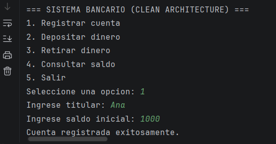
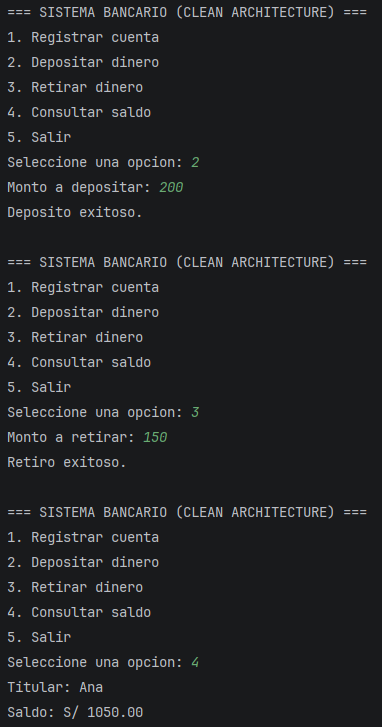
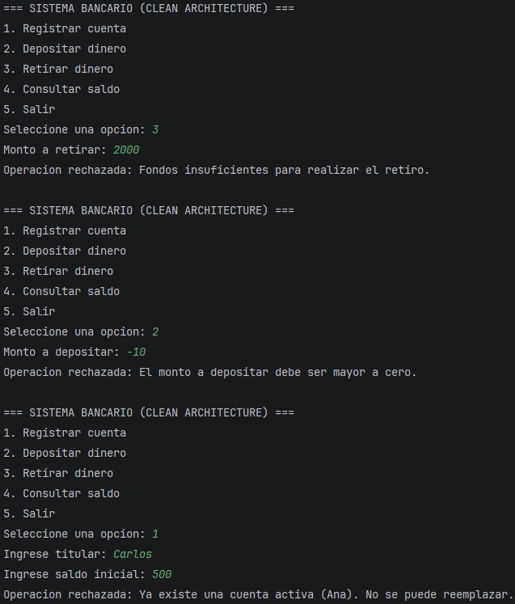
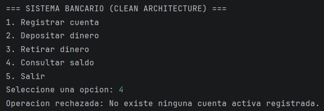
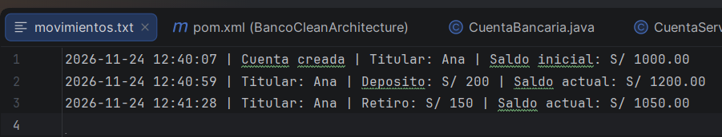

# Registro de Pruebas Funcionales

| Caso | Acción ejecutada | Resultado obtenido | Estado |
| :--- | :--- | :--- | :---: |
| **P01** | Opción `1`: Titular `Ana`, Saldo `1000` | Mensaje: *"Cuenta registrada exitosamente."* Se registra línea de creación en `movimientos.txt` con saldo `1000.00`. | Aprobado |
| **P02** | Opción `2`: Depositar `200` | Mensaje: *"Deposito exitoso."* Nuevo saldo `1200.00`; movimiento registrado en `movimientos.txt`. | Aprobado |
| **P03** | Opción `3`: Retirar `150` | Mensaje: *"Retiro exitoso."* Nuevo saldo `1050.00`; movimiento registrado en `movimientos.txt`. | Aprobado |
| **P04** | Opción `3`: Retirar `2000` | Mensaje: *"Operacion rechazada: Fondos insuficientes para realizar el retiro."* Saldo intacto (`1050.00`). No escribe en archivo. | Aprobado |
| **P05** | Opción `2`: Depositar `-10` | Mensaje: *"Operacion rechazada: El monto a depositar debe ser mayor a cero."* Saldo intacto (`1050.00`). | Aprobado |
| **P06** | Opción `1`: Registrar cuenta `Carlos` con `500` sin reiniciar | Mensaje: *"Operacion rechazada: Ya existe una cuenta activa (Ana). No se puede reemplazar."* La cuenta de Ana se mantiene intacta. | Aprobado |
| **P07** | Opción `5` (Salir) y volver a ejecutar `Main` | El sistema muestra advertencia inicial indicando que `movimientos.txt` solo es un historial y no restaura automáticamente la cuenta anterior. Al consultar saldo (Opción `4`), informa que no hay cuenta activa. | Aprobado |

## Nota sobre `movimientos.txt`
El archivo `movimientos.txt` generado en la raíz del proyecto actúa exclusivamente como un **log de auditoría (historial append-only)** de las transacciones ocurridas. No constituye un mecanismo de persistencia de estado de entidades, por lo que al finalizar la ejecución de la JVM el estado de `CuentaBancaria` en memoria se libera.

## Evidencias de Ejecución

### Caso P01: Registro de cuenta inicial

### Casos P02, P03 y Consulta de Saldo

### Casos P04, P05 y P06 (Validaciones de negocio)

### Caso P07: Reinicio del sistema y advertencia de memoria

### Archivo de historial `movimientos.txt`
